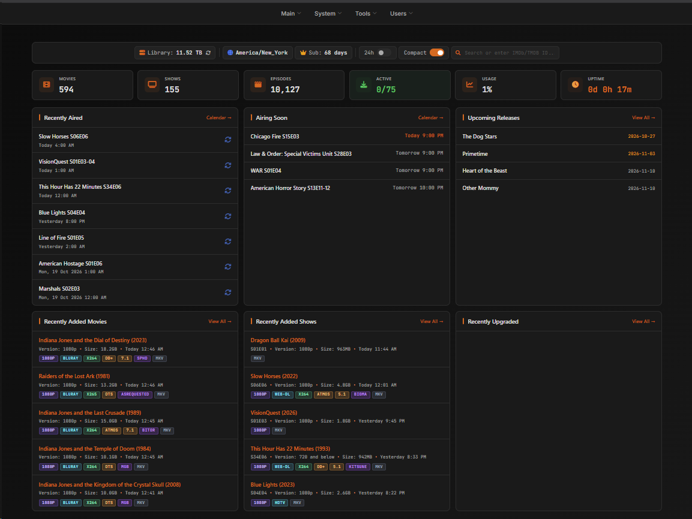
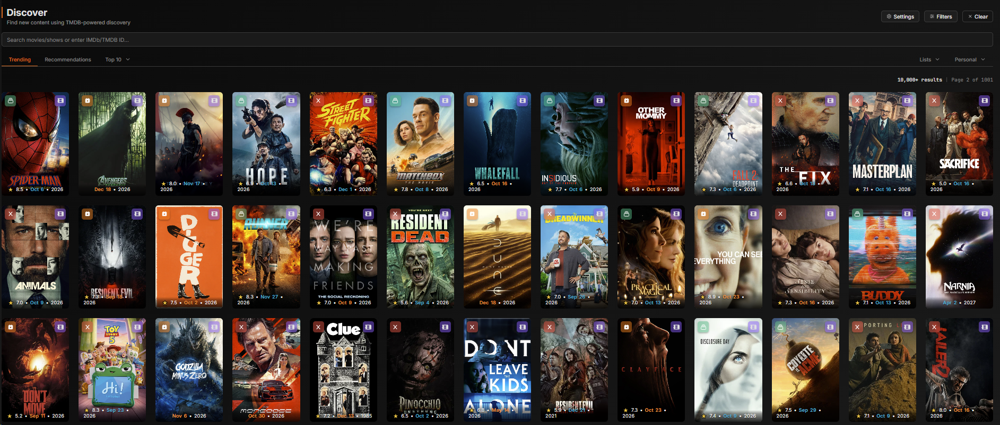
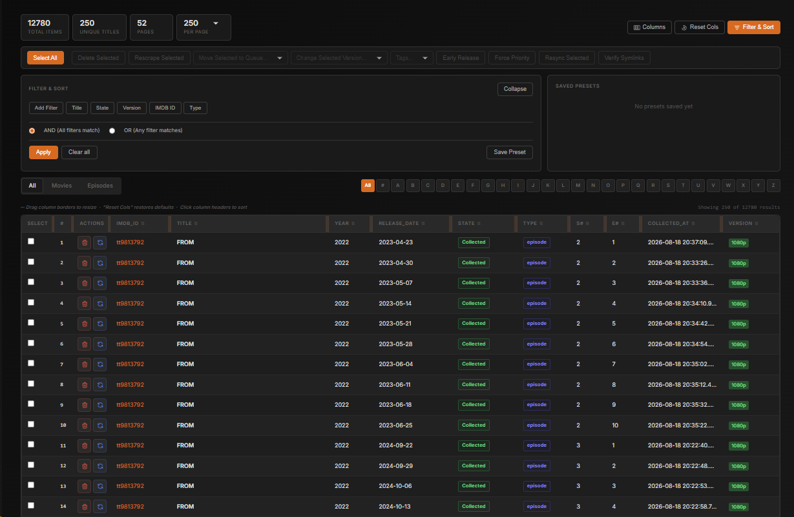
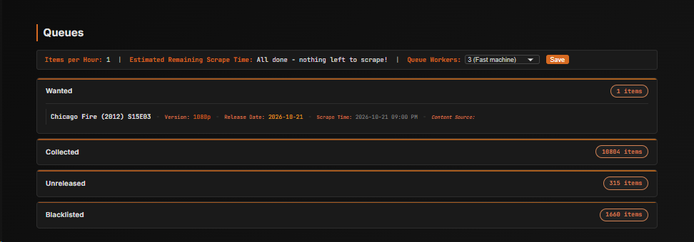

<p align="center">
  <picture>
    <source media="(prefers-color-scheme: dark)" srcset="docs/brand/clyde-logo-white.svg">
    
  </picture>
</p>

# Clyde (formerly cli_debrid)

*Same app, same images and settings, new name. See [Renamed from cli_debrid](#renamed-from-cli_debrid).*

[](https://github.com/godver3/cli_debrid/releases)
[](https://github.com/godver3/cli_debrid/releases/latest)
[](https://discord.gg/ynqnXGJ4hU)

Clyde is a successor to, and pays homage to, plex_debrid. It watches your lists, finds the best release for everything on them, gets it through your debrid service or Usenet, and keeps your Plex or Jellyfin library organised and upgraded, with no files downloaded to your server. Its **built-in mount** streams your debrid account and your Usenet server itself, so a single container is all you need.

It works with **Real-Debrid, AllDebrid, TorBox, Premiumize, Debrid-Link and HighWay**, and with **Usenet (NZB)**, for **Plex, Jellyfin and Emby**. You can also use a separate mount: cli_mount, Decypharr, NzbDAV or Zurg.

**📖 [Getting Started](#getting-started)** · [Documentation](https://godver3.github.io/cli_docs/) · [Discord](https://discord.gg/ynqnXGJ4hU)

> [!IMPORTANT]
> **The `dev` branch is recommended.** Run the `godver3/clyde:dev` image (the compose files below already do). It gets new features and fixes first; `main` is updated less often. See [dev vs main](#dev-vs-main).

## Getting Started

New to Clyde? Start with the **[Getting Started guide](https://godver3.github.io/cli_docs/getting-started/)**: prerequisites, mounting your debrid storage, installing, and your first content sources and scrapers.

### Quick Start (Docker)

The easiest setup is a single container: Clyde with its **built-in mount**, which streams your debrid account and your Usenet server itself. Onboarding sets it up and checks at the end that Clyde and your media server see the same folders.

```bash
# Linux with Docker Engine
mkdir -p ${HOME}/clyde && cd ${HOME}/clyde
curl -o docker-compose.yml https://raw.githubusercontent.com/godver3/cli_debrid/dev/docker-compose.builtin.yml
docker compose up -d
```

Then open Clyde at `http://your-server-ip:5000` and follow the onboarding wizard. Keep **Built-in mount** as the mount tool; it fills in `/mnt/clid/__all__`. Give your media server the same folders at the same paths: `/mnt/clid` (with `:rslave` if it runs in Docker) and, for Symlink mode, `/mnt/symlinks`. The compose file has a Plex service you can uncomment. The [built-in mount guide](https://godver3.github.io/cli_docs/integrations/builtin-mount/) covers the settings, WebDAV for a media server on another machine, and moving over from cli_mount.

**Prefer a separate mount container?** [docker-compose.cli_mount.yml](https://raw.githubusercontent.com/godver3/cli_debrid/dev/docker-compose.cli_mount.yml) runs Clyde and **[cli_mount](https://github.com/mash2k3/decypharr/tree/dev)** together:

```bash
# Create the shared folders once:
sudo mkdir -p /mnt/cli_mount /mnt/symlinks
sudo chown 1000:1000 /mnt/cli_mount

mkdir -p ${HOME}/clyde && cd ${HOME}/clyde
curl -o docker-compose.yml https://raw.githubusercontent.com/godver3/cli_debrid/dev/docker-compose.cli_mount.yml
docker compose up -d
```

1. Open cli_mount at `http://your-server-ip:8282` and add your debrid account and/or Usenet server. When the setup wizard asks, set the **Download Folder** to `/app/downloads`, the **Mount Path** to `/mnt/cli_mount` and the **Cache Directory** to `/app/cache`.
2. Open Clyde at `http://your-server-ip:5000` and follow the onboarding wizard. Choose **cli_mount** as the mount tool, with the mount path `/mnt/cli_mount/__all__`. If you use Usenet, click **Detect** next to the mount URL; it finds `http://cli_mount:8282`. After onboarding, **Settings → Required → Usenet Mount → Detect** also fills in cli_mount's data path (`/climount_data`), which turns on backups of cli_mount's databases.
3. Give your media server the same folders at the same paths: `/mnt/cli_mount` (with `:rslave` if it runs in Docker) and, for Symlink mode, `/mnt/symlinks`.

The [Docker guide](https://godver3.github.io/cli_docs/installation/docker/) explains each line and covers Plex in the same stack. Already have a mount, or using Zurg or Decypharr? Use the plain [docker-compose.yml](https://raw.githubusercontent.com/godver3/cli_debrid/dev/docker-compose.yml) instead.

Each image tag works on both AMD64 and ARM64:

- **Dev (recommended)**: `godver3/clyde:dev` (also `:latest`)
- **Main**: `godver3/clyde:main`

The old name, `godver3/cli_debrid`, gets the same builds under the same tags, so existing installs don't need to change anything.

Clyde needs a mount for your debrid and/or Usenet files: its own built-in mount, or a separate one. **[cli_mount](https://github.com/mash2k3/decypharr/tree/dev)** is mash2k3's fork of Decypharr built alongside Clyde; it handles debrid and Usenet in its own container and talks to Clyde directly for repairs and imports.

| Mount | Debrid | Usenet | Notes |
|---|---|---|---|
| [Built-in mount](https://godver3.github.io/cli_docs/integrations/builtin-mount/) | ✓ | ✓ | **Easiest.** Runs inside Clyde, no extra container |
| [cli_mount](https://github.com/mash2k3/decypharr/tree/dev) ([setup](https://godver3.github.io/cli_docs/integrations/cli_mount/)) | ✓ | ✓ | All-in-one in its own container, built for Clyde |
| [Decypharr](https://godver3.github.io/cli_docs/integrations/decypharr/) | ✓ | ✓ | All-in-one debrid and Usenet mount |
| [Zurg](https://godver3.github.io/cli_docs/integrations/zurg/) + rclone | ✓ | ✓ (Zurg 2.0) | Long-standing Real-Debrid favourite |

*If running on Windows, Developer Mode must be enabled to allow symlinking. Plex does not support symlinks on Windows, so Jellyfin is the better choice there when using symlinks.*

### Documentation

- **Installing:** [Docker](https://godver3.github.io/cli_docs/installation/docker/), [Unraid](https://godver3.github.io/cli_docs/installation/unraid/), [Portainer/Dockge](https://godver3.github.io/cli_docs/installation/portainer-dockge/), [Proxmox](https://godver3.github.io/cli_docs/installation/proxmox/), [TrueNAS](https://godver3.github.io/cli_docs/installation/truenas/), [Ubuntu](https://godver3.github.io/cli_docs/installation/ubuntu/), [Windows](https://godver3.github.io/cli_docs/installation/windows/), [Updating](https://godver3.github.io/cli_docs/installation/updating/)
- **Configuring:** [Required](https://godver3.github.io/cli_docs/configuration/required/), [Content Sources](https://godver3.github.io/cli_docs/configuration/content-sources/), [Scrapers](https://godver3.github.io/cli_docs/configuration/scrapers/), [Versions](https://godver3.github.io/cli_docs/configuration/versions/), [Users](https://godver3.github.io/cli_docs/configuration/manage-users/), [Notifications](https://godver3.github.io/cli_docs/configuration/notifications/)
- **Scrapers:** [Torrentio](https://godver3.github.io/cli_docs/scrapers/torrentio/), [Jackett](https://godver3.github.io/cli_docs/scrapers/jackett/), [Prowlarr](https://godver3.github.io/cli_docs/scrapers/prowlarr/), [Zilean](https://godver3.github.io/cli_docs/scrapers/zilean/), [Nyaa](https://godver3.github.io/cli_docs/scrapers/nyaa/), [MediaFusion](https://godver3.github.io/cli_docs/scrapers/mediafusion/), [AIOStreams](https://godver3.github.io/cli_docs/scrapers/aiostreams/), [Newznab](https://godver3.github.io/cli_docs/scrapers/newznab/)
- **Integrations:** [Built-in mount](https://godver3.github.io/cli_docs/integrations/builtin-mount/), [cli_mount](https://godver3.github.io/cli_docs/integrations/cli_mount/), [Decypharr](https://godver3.github.io/cli_docs/integrations/decypharr/), [Zurg](https://godver3.github.io/cli_docs/integrations/zurg/), [Plex](https://godver3.github.io/cli_docs/integrations/plex/), [Jellyfin](https://godver3.github.io/cli_docs/integrations/jellyfin/), [Seerr](https://godver3.github.io/cli_docs/integrations/seerr/)
- **Features:** [Library](https://godver3.github.io/cli_docs/features/library/), [Queues](https://godver3.github.io/cli_docs/features/queues/), [Upgrade Hub](https://godver3.github.io/cli_docs/features/upgrade-hub/), [Discover](https://godver3.github.io/cli_docs/features/discover/), [Overlays](https://godver3.github.io/cli_docs/features/overlays/), [Plex Collections](https://godver3.github.io/cli_docs/features/plex-collections/), [Debrid Manager](https://godver3.github.io/cli_docs/features/debrid-manager/), [Scraper Tester](https://godver3.github.io/cli_docs/features/scraper-tester/), [Automation](https://godver3.github.io/cli_docs/features/automation/), [Tools](https://godver3.github.io/cli_docs/features/tools/), [Maintenance](https://godver3.github.io/cli_docs/features/maintenance/)
- **Troubleshooting:** [FAQ](https://godver3.github.io/cli_docs/faq/)

### dev vs main

**dev is recommended.** It gets new features and fixes first, and every new version is built and published from it.

**main** is a snapshot of dev that's updated less often, at the end of each development cycle. Use it only if you'd rather update rarely.

## Screenshots

**Dashboard:** library totals, what's airing, and what was just added or upgraded.



**Discover:** browse trending titles, recommendations and lists, and request them in one click.



**Database:** every movie and episode Clyde tracks, with filters, saved presets and bulk actions.



**Queues:** what's wanted, unreleased, collected or blacklisted.



## How it works

```
Content sources ──> Scrapers ──> Debrid / Usenet ──> Mount ──> Library ──> Plex / Jellyfin / Emby
 (what you want)    (find it)     (get it)            (stream)   (organise)  (watch)
```

1. **Content sources** say what you want: watchlists, lists, requests.
2. **Scrapers** search torrent indexers and Usenet indexers. Results are ranked against your **Versions**, the quality profiles you define (resolution, size, codecs, languages, preferred groups).
3. The best cached release goes to your **debrid service** or your **Usenet provider**.
4. A **mount** (Clyde's built-in mount, or cli_mount, Decypharr or Zurg + rclone) streams the files from the cloud. Nothing is downloaded to your server.
5. Clyde files them into your **library**, as Plex-tracked items or a symlinked folder tree, tells your media server to scan, and keeps looking for **upgrades**.

## Coming from another setup?

- **plex_debrid:** Clyde is its successor. It does the same job (watchlists in, cached releases out, Plex library kept up to date) with a web interface, a local database of what you have, and automatic upgrades and repairs.
- **Sonarr/Radarr with a debrid downloader:** Clyde takes the place of the *arr apps and the download client. It scrapes, ranks releases against your Versions, sends them to your debrid service or Usenet provider, and builds the library. Bazarr can still connect to it as if it were Sonarr/Radarr.
- **Usenet with SABnzbd or NZBGet:** NZBs are streamed from your news server through the mount, with nothing downloaded first. See the [built-in mount guide](https://godver3.github.io/cli_docs/integrations/builtin-mount/) (or the [cli_mount setup guide](https://godver3.github.io/cli_docs/integrations/cli_mount/) for a separate container).

## Key Features

### Built-in mount
- **One container:** Clyde streams your debrid account and your Usenet server through its own mount, so you don't need rclone, Zurg or a separate mount container. Onboarding sets it up and checks that your media server sees the same folders.
- **Made for streaming:** fast first play, the next episode warmed up before you reach it (Plex), and playing streams put ahead of library scans and imports.
- **Mount page:** queue, file browser, live streams, per-server stats and the mount log, with Start and Stop that don't depend on the rest of the app.
- **Health and repair:** missing Usenet articles and dead debrid links are proven, not guessed, and the release is replaced automatically.
- **Extras:** WebDAV for a media server on another machine, Movies and TV Shows folders out of the box, password-protected RAR and 7z releases (password from the NZB), and a Migrate from cli_mount tab that keeps your existing jobs. See the [built-in mount guide](https://godver3.github.io/cli_docs/integrations/builtin-mount/).
- **Built on Decypharr:** the mount engine adapts parts of [Decypharr](https://github.com/sirrobot01/decypharr) by way of mash2k3's [cli_mount](https://github.com/mash2k3/decypharr/tree/dev) fork (Usenet decoding and RAR / par2 handling); see [engine/NOTICE.md](engine/NOTICE.md).

### Getting content
- **Debrid providers:** Real-Debrid, AllDebrid, Premiumize, TorBox, Debrid-Link and HighWay.
- **Usenet:** NZBs from your Newznab indexers, streamed through the [built-in mount](https://godver3.github.io/cli_docs/integrations/builtin-mount/), [cli_mount](https://github.com/mash2k3/decypharr/tree/dev), NzbDAV or Zurg, with no download step. Usenet can be used alone or next to a debrid service.
- **Scrapers:** Torrentio, Jackett, Prowlarr, Zilean, Nyaa, MediaFusion, AIOStreams and Newznab, with SeaDex for best-release anime picks.
- **Content sources:** MDBList, Trakt (watchlists, lists, collection, friends), Plex (your watchlist, other users' and friends' watchlists, RSS), Seerr/Overseerr, Agregarr, Scrob, Adaptive Lists and your existing collection.
- **Manual and magnet assign:** paste a magnet, torrent or NZB, then map the files to episodes yourself or let the matcher do it. It understands season packs, absolute-numbered anime packs and multi-episode files, and can replace episodes already in your library.

### Keeping it healthy
- **Upgrading:** collected items keep getting checked for better releases within your upgrade window.
- **Repair:** broken or incomplete files (dead torrents, missing Usenet articles) are detected and replaced automatically.
- **Blacklisting and not-wanted lists:** bad releases aren't picked again.
- **Sync deletions:** removing something from your media server or a source can remove it from Clyde too.

### Anime and TV
- **Absolute numbering:** packs like `Show - 152.mkv` or `S01E152` are matched to the right season and episode.
- **Episode orders:** each show can follow TVDB aired, DVD or absolute order, or any TMDB episode group. Collected files are renamed to match, and Plex's ordering is kept in sync.
- **Per-show anime setting**, romaji and alternative-title searching, and seasons that are really movies (e.g. *Initial D Third Stage*).

### Library and media servers
- **Direct Mount or symlinked library:** with Direct Mount your media server (Plex, Silo, Jellyfin or Emby) reads the mount itself and Clyde tracks your library through its API. Symlinked/Local builds a clean folder tree from your mount, with naming templates, for Plex, Jellyfin, Emby or Silo.
- **Plex extras:** collections, smart collections, labels, movie box sets and poster overlays.
- **Subtitle manager** (Tools → Subtitles): finds subtitles that match your exact release by file hash and release name, from OpenSubtitles, SubDL, SubSource and more. See what each item has, search and compare scores, pick one or let it choose, fill in everything that's missing in one go, and import your existing subtitles from Bazarr. Bazarr can still connect to Clyde as if it were Radarr/Sonarr.

### Web interface
- **Library, Discover, Calendar, Upgrade Hub, Debrid Manager, Statistics and Task Manager.**
- **Scraper Tester:** see exactly how each release is scored, and tune your Versions until the right one wins.
- **Multiple users** with roles (admin, user, requester) and optional SSO (Authentik, Authelia or generic OIDC).
- **AI Butler:** an optional chat assistant through [OpenClaw](https://godver3.github.io/cli_docs/integrations/openclaw/).
- **Notifications:** Discord, Telegram, NTFY and Email.
- **Metadata battery:** metadata is cached locally to keep external API calls to a minimum.

## Usenet

Clyde can use Usenet as a source alongside, or instead of, a debrid service:

1. Add your Newznab indexers as scrapers ([guide](https://godver3.github.io/cli_docs/scrapers/newznab/)).
2. Set up a Usenet provider. The **[built-in mount](https://godver3.github.io/cli_docs/integrations/builtin-mount/)** is the default for new installs: Clyde streams NZBs straight from your news server through its own mount, which also serves your debrid account, so nothing is downloaded first. **[cli_mount](https://github.com/mash2k3/decypharr/tree/dev)** ([setup guide](https://godver3.github.io/cli_docs/integrations/cli_mount/)) does the same in its own container, and NzbDAV and Zurg are also supported. Existing installs keep the provider they already use.
3. Enable Usenet under **Settings → Required Settings → Usenet Provider**.

NZB results are ranked with your torrent results using the same Versions. Releases with missing articles are caught and replaced automatically.

## Firefox Extension

Clyde works with a Firefox extension called **cli_debrid magnet assign** that integrates with [debridmediamanager.com](https://debridmediamanager.com) to pre-populate the magnet assignment tool with information from DMM.

**Download**: [Firefox Add-on](https://addons.mozilla.org/firefox/downloads/file/4567721/baa7b13ad11b4c308b3e-1.2.xpi)

**Requirements**: version 0.7.12 or newer

Add your Clyde instance URL, username and password, and magnets you pick on DMM arrive in the assign tool already filled in.

## How can you support the project?

[](https://github.com/sponsors/godver3)
[](https://patreon.com/godver3)
[](https://ko-fi.com/godver3)

Clyde will always be free.

## Renamed from cli_debrid

cli_debrid is now called Clyde. Only the name and logo changed:

- **Updating needs nothing from you.** The Docker image is now `godver3/clyde`, but `godver3/cli_debrid` keeps getting every build under the same tags, so an existing install keeps updating as it is. To switch, change `godver3/cli_debrid` to `godver3/clyde` in your compose file and recreate the container; your config, database and logs stay where they are.
- **Environment variables, folder names and the GitHub address** keep the `cli_debrid` name for now, so existing compose files, scripts and links keep working.
- **The Firefox extension** is still listed as *cli_debrid magnet assign*.

## Community

- [Discord](https://discord.gg/ynqnXGJ4hU): join to ask questions or share ideas.

## Philosophy

### Database and "I Know What I Got"

Clyde maintains a local database of your media collection, keeping track of what you have and what quality it's in. This "I Know What I Got" approach lets Clyde keep a list of what you have and what you want. Other goals are minimal API calls, high specificity in scraping, and an easy-to-use interface on top of a thorough backend.

## Issues

Submit issues through Discord or GitHub issues. Include relevant logs, or at minimum error tracebacks, where possible. Discord is preferred. The **Share logs** button on the Logs page uploads your logs and current settings (tokens, keys and usernames redacted) and gives you a link to post.

## Contributing

Contributions are welcome through Issues or pull requests against the `dev` branch.

## License

Clyde will always be free for anyone to use.

## Acknowledgements

Thanks to:

- Various other projects that have come before this one, and likely do things better in many ways
- Specific thanks to the NyaaPy, PTT/Parsett, and downsub libraries (https://github.com/JuanjoSalvador/NyaaPy, https://github.com/dreulavelle/PTT, and https://github.com/ericvlog/Downsub)
- mash2k3 for [cli_mount](https://github.com/mash2k3/decypharr/tree/dev), the Decypharr fork built alongside Clyde, which parts of the built-in mount are adapted from, and sirrobot01 for the original [Decypharr](https://github.com/sirrobot01/decypharr)
- The original creator of plex_debrid.
- Helpful communities of content creators

## Caveat

I'll include a caveat that this project was built almost entirely using AI (though I have a bit of experience working with code in the past). I would say I learned a fair bit through the process and overall enjoyed getting to this point. That said, I'll do what I can to fix things, but Clyde is built almost entirely on spaghetti and probably has lots of brow-raising content. Apologies in advance real devs who decide to look under the hood.
