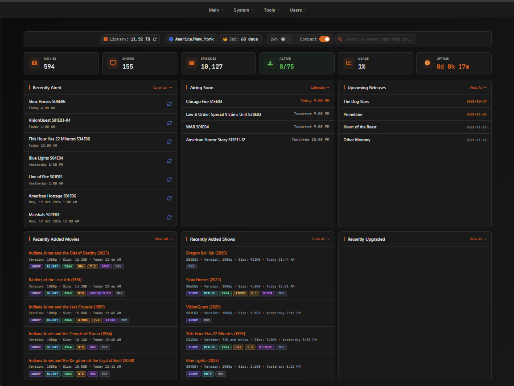
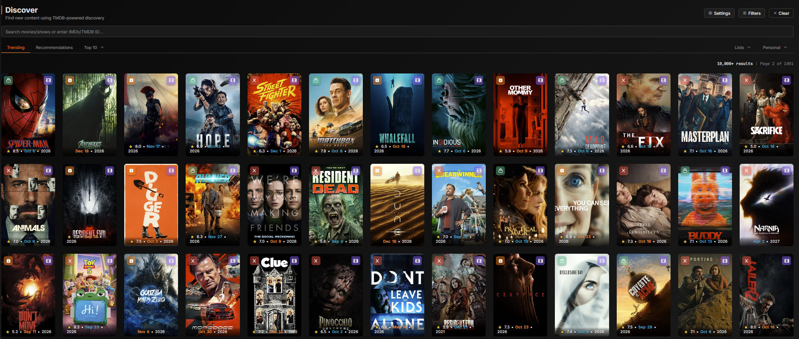
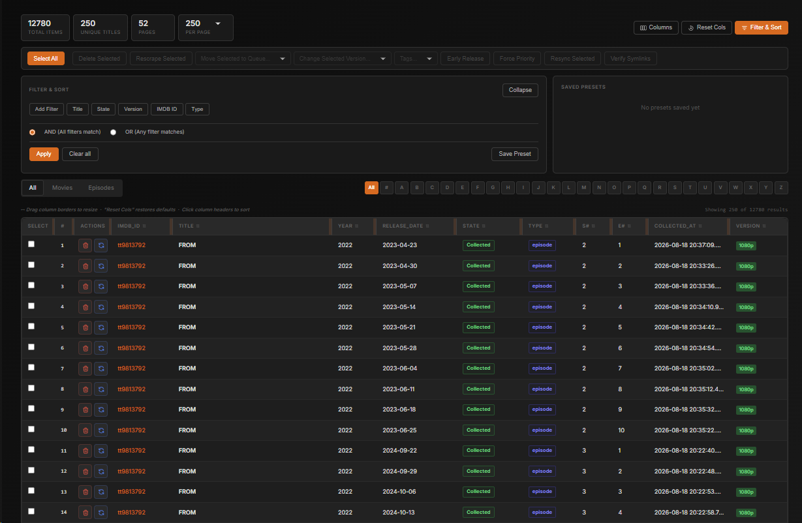
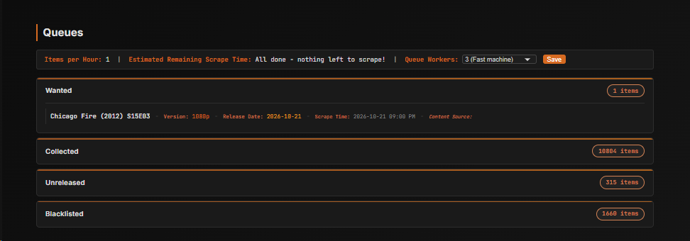

# cli_debrid

cli_debrid is a successor to, and pays homage to, plex_debrid. It watches your lists, finds the best release for everything on them, gets it through your debrid service or Usenet, and keeps your Plex or Jellyfin library organised and upgraded, with no files downloaded to your server.

It works with **Real-Debrid, AllDebrid, TorBox, Premiumize and Debrid-Link**, and with **Usenet (NZB)** through cli_mount, NzbDAV or Zurg, for **Plex, Jellyfin and Emby**.

**📖 [Getting Started](https://godver3.github.io/cli_docs/getting-started/)** · [Documentation](https://godver3.github.io/cli_docs/) · [Discord](https://discord.gg/ynqnXGJ4hU)

## How can you support the project?

[](https://github.com/sponsors/godver3)
[](https://patreon.com/godver3)
[](https://ko-fi.com/godver3)

cli_debrid will always be free.

## Version Information

*Main Branch*


*Dev Branch*


## Community

- [Discord](https://discord.gg/ynqnXGJ4hU): join to ask questions or share ideas.

## Screenshots

**Dashboard:** library totals, what's airing, and what was just added or upgraded.



**Discover:** browse trending titles, recommendations and lists, and request them in one click.



**Database:** every movie and episode cli_debrid tracks, with filters, saved presets and bulk actions.



**Queues:** what's wanted, unreleased, collected or blacklisted.



## How it works

```
Content sources ──> Scrapers ──> Debrid / Usenet ──> Mount ──> Library ──> Plex / Jellyfin / Emby
 (what you want)    (find it)     (get it)            (stream)   (organise)  (watch)
```

1. **Content sources** say what you want: watchlists, lists, requests.
2. **Scrapers** search torrent indexers and Usenet indexers. Results are ranked against your **Versions**, the quality profiles you define (resolution, size, codecs, languages, preferred groups).
3. The best cached release goes to your **debrid service** or your **Usenet provider**.
4. A **mount** (cli_mount, Decypharr or Zurg + rclone) streams the files from the cloud. Nothing is downloaded to your server.
5. cli_debrid files them into your **library**, as Plex-tracked items or a symlinked folder tree, tells your media server to scan, and keeps looking for **upgrades**.

## Coming from another setup?

- **plex_debrid:** cli_debrid is its successor. It does the same job (watchlists in, cached releases out, Plex library kept up to date) with a web interface, a local database of what you have, and automatic upgrades and repairs.
- **Sonarr/Radarr with a debrid downloader:** cli_debrid takes the place of the *arr apps and the download client. It scrapes, ranks releases against your Versions, sends them to your debrid service or Usenet provider, and builds the library. Bazarr can still connect to it as if it were Sonarr/Radarr.
- **Usenet with SABnzbd or NZBGet:** NZBs are streamed from your news server through the mount, with nothing downloaded first. See [Usenet migration](https://godver3.github.io/cli_docs/features/usenet-migration/).

## Key Features

### Getting content
- **Debrid providers:** Real-Debrid, AllDebrid, Premiumize, TorBox and Debrid-Link.
- **Usenet:** NZBs from your Newznab indexers, streamed through [cli_mount](https://github.com/mash2k3/decypharr/tree/dev), NzbDAV or Zurg, with no download step. Usenet can be used alone or next to a debrid service.
- **Scrapers:** Torrentio, Jackett, Prowlarr, Zilean, Nyaa, MediaFusion, AIOStreams and Newznab, with SeaDex for best-release anime picks.
- **Content sources:** MDBList, Trakt (watchlists, lists, collection, friends), Plex (your watchlist, other users' and friends' watchlists, RSS), Seerr/Overseerr, Agregarr, Scrob, Adaptive Lists and your existing collection.
- **Manual and magnet assign:** paste a magnet, torrent or NZB, then map the files to episodes yourself or let the matcher do it. It understands season packs, absolute-numbered anime packs and multi-episode files, and can replace episodes already in your library.

### Keeping it healthy
- **Upgrading:** collected items keep getting checked for better releases within your upgrade window.
- **Repair:** broken or incomplete files (dead torrents, missing Usenet articles) are detected and replaced automatically.
- **Blacklisting and not-wanted lists:** bad releases aren't picked again.
- **Sync deletions:** removing something from your media server or a source can remove it from cli_debrid too.

### Anime and TV
- **Absolute numbering:** packs like `Show - 152.mkv` or `S01E152` are matched to the right season and episode.
- **Episode orders:** each show can follow TVDB aired, DVD or absolute order, or any TMDB episode group. Collected files are renamed to match, and Plex's ordering is kept in sync.
- **Per-show anime setting**, romaji and alternative-title searching, and seasons that are really movies (e.g. *Initial D Third Stage*).

### Library and media servers
- **Plex or symlinked library:** Plex mode tracks your library through Plex's API. Symlinked mode builds a clean folder tree from your mount, with naming templates, for Plex, Jellyfin or Emby.
- **Plex extras:** collections, smart collections, labels, movie box sets and poster overlays.
- **Subtitles:** built-in subtitle downloading, or let Bazarr connect to cli_debrid as if it were Radarr/Sonarr.

### Web interface
- **Library, Discover, Calendar, Upgrade Hub, Debrid Manager, Statistics and Task Manager.**
- **Scraper Tester:** see exactly how each release is scored, and tune your Versions until the right one wins.
- **Multiple users** with roles (admin, user, requester) and optional SSO (Authentik, Authelia or generic OIDC).
- **AI Butler:** an optional chat assistant through [OpenClaw](https://godver3.github.io/cli_docs/integrations/openclaw/).
- **Notifications:** Discord, Telegram, NTFY and Email.
- **Metadata battery:** metadata is cached locally to keep external API calls to a minimum.

## Usenet

cli_debrid can use Usenet as a source alongside, or instead of, a debrid service:

1. Add your Newznab indexers as scrapers ([guide](https://godver3.github.io/cli_docs/scrapers/newznab/)).
2. Set up a Usenet provider. **[cli_mount](https://github.com/mash2k3/decypharr/tree/dev)** is recommended ([setup guide](https://godver3.github.io/cli_docs/integrations/cli_mount/)), and NzbDAV and Zurg are also supported. cli_mount streams NZBs straight from your news server through the same mount it uses for debrid, so nothing is downloaded first.
3. Enable Usenet under **Settings → Required Settings → Usenet Provider**.

NZB results are ranked with your torrent results using the same Versions. Releases with missing articles are caught and replaced automatically. Coming from another Usenet setup? See [Usenet migration](https://godver3.github.io/cli_docs/features/usenet-migration/).

## Firefox Extension

cli_debrid offers a Firefox extension called **cli_debrid magnet assign** that integrates with [debridmediamanager.com](https://debridmediamanager.com) to pre-populate the magnet assignment tool with information from DMM.

**Download**: [Firefox Add-on](https://addons.mozilla.org/firefox/downloads/file/4567721/baa7b13ad11b4c308b3e-1.2.xpi)

**Requirements**: Minimum cli_debrid version 0.7.12

Add your cli_debrid instance URL, username and password, and magnets you pick on DMM arrive in the assign tool already filled in.

## Getting Started

New to cli_debrid? Start with the **[Getting Started guide](https://godver3.github.io/cli_docs/getting-started/)**: prerequisites, mounting your debrid storage, installing, and your first content sources and scrapers.

### Quick Start (Docker)

```bash
mkdir -p ${HOME}/cli_debrid && cd ${HOME}/cli_debrid
curl -O https://raw.githubusercontent.com/godver3/cli_debrid/main/docker-compose.yml
docker compose up -d
```

Then open `http://your-server-ip:5000` and follow the onboarding wizard.

cli_debrid is built for both AMD64 and ARM64:

- **Stable**: `godver3/cli_debrid:main` / `godver3/cli_debrid:main-arm64`
- **Dev**: `godver3/cli_debrid:dev` / `godver3/cli_debrid:dev-arm64`

You'll also need a mount for your debrid and/or Usenet files. cli_debrid works best with **[cli_mount](https://github.com/mash2k3/decypharr/tree/dev)**, mash2k3's fork of Decypharr built alongside cli_debrid. It handles debrid and Usenet in one container and talks to cli_debrid directly for repairs and imports.

| Mount | Debrid | Usenet | Notes |
|---|---|---|---|
| [cli_mount](https://github.com/mash2k3/decypharr/tree/dev) ([setup](https://godver3.github.io/cli_docs/integrations/cli_mount/)) | ✓ | ✓ | **Recommended.** All-in-one, built for cli_debrid |
| [Decypharr](https://godver3.github.io/cli_docs/integrations/decypharr/) | ✓ | | All-in-one debrid mount |
| [Zurg](https://godver3.github.io/cli_docs/integrations/zurg/) + rclone | ✓ | ✓ (Zurg 2.0) | Long-standing Real-Debrid favourite |

*If running on Windows, Developer Mode must be enabled to allow symlinking. Plex does not support symlinks on Windows, so Jellyfin is the better choice there when using symlinks.*

### Documentation

- **Installing:** [Docker](https://godver3.github.io/cli_docs/installation/docker/), [Unraid](https://godver3.github.io/cli_docs/installation/unraid/), [Portainer/Dockge](https://godver3.github.io/cli_docs/installation/portainer-dockge/), [Proxmox](https://godver3.github.io/cli_docs/installation/proxmox/), [TrueNAS](https://godver3.github.io/cli_docs/installation/truenas/), [Ubuntu](https://godver3.github.io/cli_docs/installation/ubuntu/), [Windows](https://godver3.github.io/cli_docs/installation/windows/), [Updating](https://godver3.github.io/cli_docs/installation/updating/)
- **Configuring:** [Required](https://godver3.github.io/cli_docs/configuration/required/), [Content Sources](https://godver3.github.io/cli_docs/configuration/content-sources/), [Scrapers](https://godver3.github.io/cli_docs/configuration/scrapers/), [Versions](https://godver3.github.io/cli_docs/configuration/versions/), [Users](https://godver3.github.io/cli_docs/configuration/manage-users/), [Notifications](https://godver3.github.io/cli_docs/configuration/notifications/)
- **Scrapers:** [Torrentio](https://godver3.github.io/cli_docs/scrapers/torrentio/), [Jackett](https://godver3.github.io/cli_docs/scrapers/jackett/), [Prowlarr](https://godver3.github.io/cli_docs/scrapers/prowlarr/), [Zilean](https://godver3.github.io/cli_docs/scrapers/zilean/), [Nyaa](https://godver3.github.io/cli_docs/scrapers/nyaa/), [MediaFusion](https://godver3.github.io/cli_docs/scrapers/mediafusion/), [AIOStreams](https://godver3.github.io/cli_docs/scrapers/aiostreams/), [Newznab](https://godver3.github.io/cli_docs/scrapers/newznab/)
- **Integrations:** [cli_mount](https://godver3.github.io/cli_docs/integrations/cli_mount/), [Decypharr](https://godver3.github.io/cli_docs/integrations/decypharr/), [Zurg](https://godver3.github.io/cli_docs/integrations/zurg/), [Plex](https://godver3.github.io/cli_docs/integrations/plex/), [Jellyfin](https://godver3.github.io/cli_docs/integrations/jellyfin/), [Seerr](https://godver3.github.io/cli_docs/integrations/seerr/), [OpenClaw](https://godver3.github.io/cli_docs/integrations/openclaw/)
- **Features:** [Library](https://godver3.github.io/cli_docs/features/library/), [Queues](https://godver3.github.io/cli_docs/features/queues/), [Upgrade Hub](https://godver3.github.io/cli_docs/features/upgrade-hub/), [Discover](https://godver3.github.io/cli_docs/features/discover/), [Overlays](https://godver3.github.io/cli_docs/features/overlays/), [Plex Collections](https://godver3.github.io/cli_docs/features/plex-collections/), [Debrid Manager](https://godver3.github.io/cli_docs/features/debrid-manager/), [Scraper Tester](https://godver3.github.io/cli_docs/features/scraper-tester/), [Task Manager](https://godver3.github.io/cli_docs/features/task-manager/), [AI Butler](https://godver3.github.io/cli_docs/features/ai-butler/)
- **Troubleshooting:** [FAQ](https://godver3.github.io/cli_docs/faq/), [Debug Functions](https://godver3.github.io/cli_docs/features/debug-functions/)

### dev vs main

**main** is the stable release

**dev** gets new features and fixes first. It is a good choice if you want the latest changes and don't mind reporting the occasional issue.

Development works in cycles, with dev merged into main at the end of each one.

## Philosophy

### Database and "I Know What I Got"

cli_debrid maintains a local database of your media collection, keeping track of what you have and what quality it's in. This "I Know What I Got" approach lets cli_debrid keep a list of what you have and what you want. Other goals are minimal API calls, high specificity in scraping, and an easy-to-use interface on top of a thorough backend.

## Issues

Submit issues through Discord or GitHub issues. Include relevant logs, or at minimum error tracebacks, where possible. Discord is preferred. The **Share logs** button on the Logs page uploads your logs and current settings (tokens, keys and usernames redacted) and gives you a link to post.

## Contributing

Contributions are welcome through Issues or pull requests against the `dev` branch.

## License

cli_debrid will always be free for anyone to use.

## Acknowledgements

Thanks to:

- Various other projects that have come before this one, and likely do things better in many ways
- Specific thanks to the NyaaPy, PTT/Parsett, and downsub libraries (https://github.com/JuanjoSalvador/NyaaPy, https://github.com/dreulavelle/PTT, and https://github.com/ericvlog/Downsub)
- mash2k3 for [cli_mount](https://github.com/mash2k3/decypharr/tree/dev), the Decypharr fork that powers cli_debrid's debrid and Usenet mounting, and sirrobot01 for the original [Decypharr](https://github.com/sirrobot01/decypharr)
- The original creator of plex_debrid.
- Helpful communities of content creators

## Caveat

I'll include a caveat that this project was built almost entirely using AI (though I have a bit of experience working with code in the past). I would say I learned a fair bit through the process and overall enjoyed getting to this point. That said, I'll do what I can to fix things, but cli_debrid is built almost entirely on spaghetti and probably has lots of brow-raising content. Apologies in advance real devs who decide to look under the hood.
